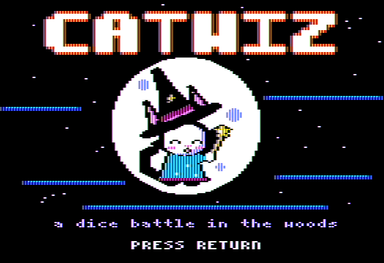
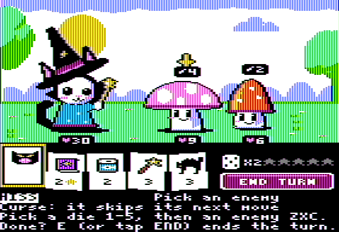
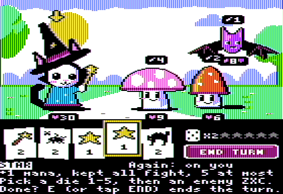
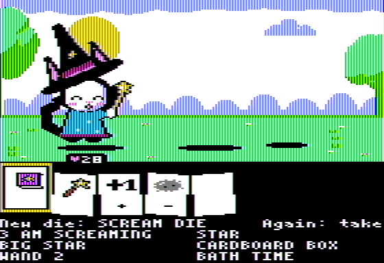
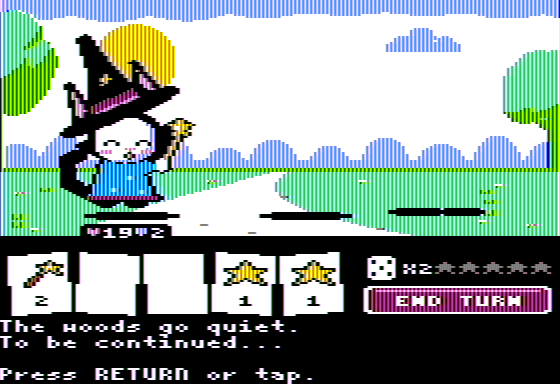
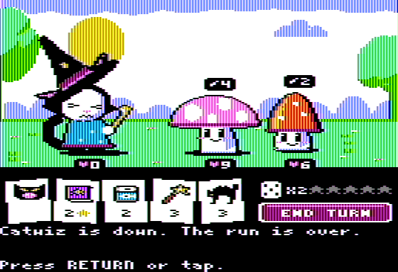

# Catwiz

A dice roguelike for the 128K Apple IIe, in double hi-res graphics. You are a cat wizard rolling
a bag of dice against the forest's spooky-cute things, on the way to a big bad dog. Written in
[Tisple](https://github.com/wegfawefgawefg/tisple), a typed Lisp that compiles to 6502.

Two fights and the reward between them play now; ten are planned. The project is shelved.

**[Play it in your browser](https://wegfawefgawefg.github.io/tisple/play.html?game=catwiz)** (phone or desktop), or
get the disk from the [releases](https://github.com/wegfawefgawefg/catwiz/releases).

On a TV or composite monitor (NTSC), the look it is drawn for:

 

 

 

In flat colour (an RGB monitor, the web player's other look):
[title](shots/title_color.png), [fight 1](shots/fight1_color.png), [fight 2](shots/fight2_color.png),
[reward](shots/reward_color.png), [won](shots/win_color.png), [lost](shots/lose_color.png).

## Playing

Each turn five dice come out of your bag and roll. Each face is something to do: a wand hits,
tuna heals, fluff shields you till your next turn, a star adds mana, a book casts a spell
that costs mana, +1 and x2 boost the next die, and some faces are curses for an enemy. The
enemies show what they will do next. At the end of the turn the dice go to the discard; when
the bag runs out, the discard is shuffled back in. After a won fight you pick a reward: a new
die for the bag, one face of a die upgraded, or a die taken out. Hit points and the bag carry
over; losing ends the run.

Everything is a tap or a click on the screen, or a key:

- A die (1-5): pick it. Its name and what it does show at the bottom; arrows show who it goes to.
- An enemy (Z, X, C, left to right; LEFT/RIGHT and RETURN too): play the picked die on it.
- The same die again, or the cat (M): play a die that goes to you; the same die again plays one
  for every enemy, and lets go of one for a single enemy. Tapping anything else, or ESC, lets go.
- The die button (R) re-rolls the dice not played yet, twice a turn; END TURN (E) ends the turn. The turn ends by
  itself when every die is played, or when none can be and there is no re-roll left.
- The cat (M) with no die for you picked meows.
- The reward works the same way with 1-4 (then 1-6); tapping elsewhere goes back to the offers.

## Building

Needs Tisple's branch `catwiz-dhgr-lib` (lib/dhgr's runs, lib/auxcard, lib/dhgr_pixels; on
top of main 7c3de44) until it is merged (C++20, CMake, Ninja; see its README):

```sh
git clone https://github.com/wegfawefgawefg/tisple
cd tisple && cmake --preset release && cmake --build --preset release   # tisple/build/tisple
```

Then, anywhere in this repo:

```sh
tisple build      # writes build/catwiz.dsk
```

`tisple.project` holds the settings: the program (`game/main.tsp`), its origin, the disk, and the
machine flags `tisple run` uses. The art is drawn in plain Python 3 (`tools/dhgr/`) and exported to
`game/art/*.tsp`, which are checked in; after changing it, run `python3 tools/dhgr/make.py`
(previews to `shots/dhgr/`, through Tisple's emulator: `TISPLE=/path/to/tisple/build/tisple`), or
`python3 tools/dhgr/game.py` for the game's tables alone.

## Running

`tisple run` builds the disk and plays it in a window with the music (Mockingboard in slot 4)
and clicks, as `tisple.project` says; flags after it win, like `tisple run --scale 3`.
`scripts/run.sh` does the same with `TISPLE` naming the compiler (default
`~/Coding/LangDev/tisple/build/tisple`, else `tisple` on the PATH). By hand, in Tisple's
emulator:

```sh
tisple machine --disk build/catwiz.dsk --window                       # speaker sound
tisple machine --disk build/catwiz.dsk --mockingboard 4 --window      # with music
tisple machine --disk build/catwiz.dsk --window --taps tools/phone/catwiz.json   # mouse taps
```

With `--taps`, a click anywhere on the screen presses what a tap there would (the dice, the
enemies, the re-roll and END buttons, the cat, the reward's slots; elsewhere ESC).

On a real enhanced IIe with 128 KB, write `build/catwiz.dsk` to a floppy (ADTPro) or put it on
a FloppyEmu, and boot it. A Mockingboard in any slot plays the music; without one the speaker
plays the effects.

## The repo

- `game/`: the game. `main.tsp` is the loop; `battle/`, `draw/`, `sound/`, `title/` the engine;
  `content/` the rules as plain tables (dice, enemies, statuses, effects, encounters); `art/`
  the generated pictures.
- `tools/dhgr/`: the art, drawn at 140 x 192 in the double hi-res colours; `game.py` writes the
  game's tables. `tools/measure.py` measures frame costs. `tools/art/` and `tools/hgr.py`: the
  hi-res art the game had until 2026-10-30, kept for the record.
- `tools/phone/catwiz.json`: the phone player's buttons (its portrait pad) and the screen's tap
  boxes, for Tisple's web player and `--taps`.
- `tools/reference/`: scripts from the prototype; see its README.
- `mockup/`: the hi-res mockups of the battle screen the look came from.
- `shots/`: screenshots (NTSC and colour); `shots/dhgr/` the art's previews; `shots/art/` the
  hi-res art's; `shots/history/` the prototype.
- `docs/plan.md`: where it stands and what is left. `AGENTS.md`: the rules for working here.

It started as Witchdog, with a dog witch for a hero, and became Catwiz when the cat took over.

Inspired by Dog Witch and Slay the Spire. The names, art, music and rules here are our own.
