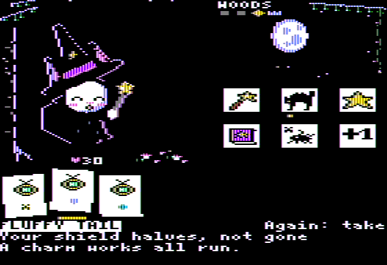
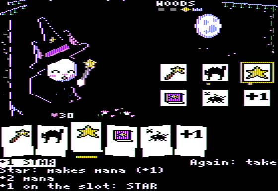
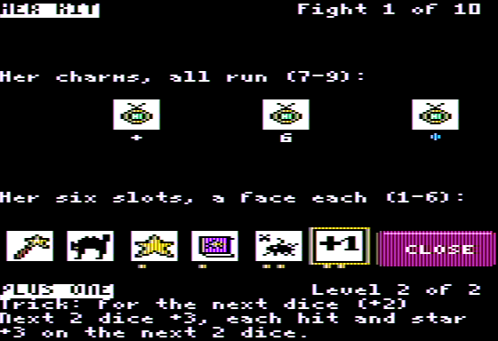
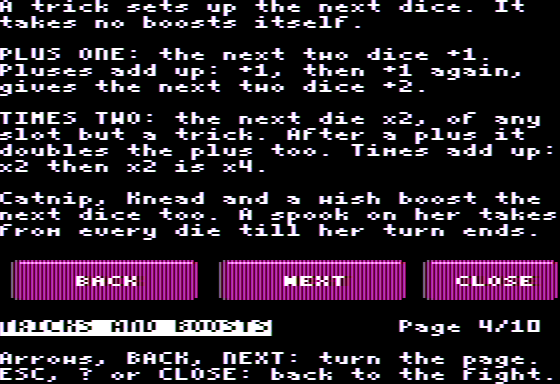
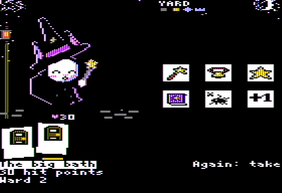
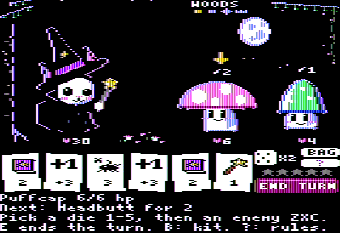

# Catwiz

A dice roguelike for the 128K Apple IIe, in double hi-res graphics. You are a cat wizard rolling
five dice of her own items against the forest's spooky-cute things, on the way to a big bad dog. Written in
[Tisple](https://github.com/wegfawefgawefg/tisple), a typed Lisp that compiles to 6502.

Two fights and what comes between them play now; ten are in the rules (the woods, the garden
and the yard, three fights each with an elite at the end, then the Bulldog King), the rest
waiting for their art.

**[Play it in your browser](https://wegfawefgawefg.github.io/tisple/play.html?game=catwiz)** (phone or desktop), or
get the disk from the [releases](https://github.com/wegfawefgawefg/catwiz/releases).

On a TV or composite monitor (NTSC), the look it is drawn for:

 

 

 

 

 

 

In flat colour (an RGB monitor, the web player's other look):
[title](shots/title_color.png), [fight 1](shots/fight1_color.png), [fight 2](shots/fight2_color.png),
[cards](shots/reward_color.png), [charm](shots/charm_color.png), [nap](shots/nap_color.png),
[bonus upgrade](shots/dream_color.png), [doors](shots/doors_color.png), [six dice](shots/toe_color.png),
[kit](shots/kit_color.png), [a charm in the kit](shots/kit_charm_color.png),
[rules](shots/rules_color.png), [won](shots/win_color.png), [lost](shots/lose_color.png). The
screens after fight 2 come from test builds (`battle/battle.tsp`'s constants).

## Playing

Each turn you roll five dice, all the same: a die's six faces are your six item slots (a wand,
a fluff, a star, a book, a curse and a trick), and the item in a slot says what its face does. A
wand hits, fluff shields you till your next turn, a star adds mana, a book casts a spell that
costs mana (with too little it gives 1), a curse goes on an enemy, a trick boosts the next dice.
Three faces of a slot in one turn set off its item's combo. The enemies show what they will do
next. After a won fight you pick one of three cards, drawn at random: a new item for a slot (the
old one goes) or a level on a slot. After each elite you also pick one of three charms, then a
nap (hit points back) or a bonus upgrade (a level on a slot of your choice); before the ninth
fight you pick one of two doors. Hit points and your kit carry over; losing ends the run. The
map at the top of the stage shows the place, its fights and the king's crown.

Everything is a tap or a click on the screen, or a key:

- A die (1-5, 1-6 with a sixth): pick it. Its item and what it does show at the bottom; arrows
  show who it goes to.
- An enemy (Z, X, C, left to right; LEFT/RIGHT and RETURN too): play the picked die on it.
- The same die again, or the cat (M): play a die that goes to you; the same die again plays one
  for every enemy, and lets go of one for a single enemy. Tapping anything else, or ESC, lets go.
- The die button (R) re-rolls the dice not played yet, twice a turn; END TURN (E) ends the turn. The turn ends by
  itself when every die is played, or when none can be and there is no re-roll left.
- The cat (M) with no die for you picked meows.
- BAG (B): her kit, a page over the stage: her six slots (in the tray's places, a pip a level)
  and her charms. Pick one (1-6 the slots, 7-9 the charms, or tap it, or the arrows) to read
  its name and level, the slot's base, the item's line and what it has going this fight (a
  three building, a plus or a times waiting, mana, kittens, a hairball, a die an enemy holds).
  ESC, B, CLOSE or a tap on the empty stage goes back to the fight.
- ? (the ? button): the rules, ten pages; the arrows, BACK and NEXT (or a tap on the page) turn
  them; ESC, ? or CLOSE goes back.
- Between fights the choices are cards in the tray, 1-3 (or 1-6 for a slot): a card picked shows
  what it changes, on the slots over the tray and in the text; the same card again takes it;
  tapping elsewhere lets go.

## Building

Needs Tisple main (lib/dhgr's runs, lib/auxcard, lib/dhgr_pixels, lib/disk; C++20, CMake,
Ninja; see its README):

```sh
git clone https://github.com/wegfawefgawefg/tisple
cd tisple && cmake --preset release && cmake --build --preset release   # tisple/build/tisple
```

Then, anywhere in this repo:

```sh
tisple build      # writes build/catwiz.dsk
```

`tisple.project` holds the settings: the program (`game/main.tsp`), its origin, the disk, and the
machine flags `tisple run` uses. The art is drawn in plain Python 3 (`tools/dhgr/`) and exported to
`game/art/*.tsp`, which are checked in; after changing it, run `python3 tools/dhgr/make.py`
(previews to `shots/dhgr/`, through Tisple's emulator: `TISPLE=/path/to/tisple/build/tisple`), or
`python3 tools/dhgr/game.py` for the game's tables alone.

## Running

`tisple run` builds the disk and plays it in a window with the music (Mockingboard in slot 4)
and clicks, as `tisple.project` says; flags after it win, like `tisple run --scale 3`.
`scripts/run.sh` does the same with `TISPLE` naming the compiler (default
`~/Coding/LangDev/tisple/build/tisple`, else `tisple` on the PATH). By hand, in Tisple's
emulator:

```sh
tisple machine --disk build/catwiz.dsk --window                       # speaker sound
tisple machine --disk build/catwiz.dsk --mockingboard 4 --window      # with music
tisple machine --disk build/catwiz.dsk --window --taps tools/phone/catwiz.json   # mouse taps
```

With `--taps`, a click anywhere on the screen presses what a tap there would (the dice, the
enemies, the re-roll, BAG, ? and END buttons, the cat, the cards between fights, the pages'
buttons; elsewhere ESC). On the phone the pad has BAG and RULES, and < > for the pages.

On a real enhanced IIe with 128 KB, write `build/catwiz.dsk` to a floppy (ADTPro) or put it on
a FloppyEmu, and boot it. A Mockingboard in any slot plays the music; without one the speaker
plays the effects.

## The repo

- `game/`: the game. `main.tsp` is the loop; `battle/`, `draw/`, `sound/`, `title/` the engine;
  `content/` the rules as plain tables (items, enemies and their moves, statuses, effects,
  charms, encounters with the draws' weighted pools, the rules page's text); `art/` the
  generated pictures, which live on the disk and load when a screen starts.
- `tools/dhgr/`: the art, drawn at 140 x 192 in the double hi-res colours; `game.py` writes the
  game's tables. `tools/measure.py` measures frame costs. `tools/art/` and `tools/hgr.py`: the
  hi-res art the game had until 2026-10-30, kept for the record.
- `tools/phone/catwiz.json`: the phone player's buttons (its portrait pad) and the screen's tap
  boxes, for Tisple's web player and `--taps`.
- `tools/reference/`: scripts from the prototype; see its README.
- `mockup/`: the hi-res mockups of the battle screen the look came from.
- `shots/`: screenshots (NTSC and colour); `shots/dhgr/` the art's previews; `shots/art/` the
  hi-res art's; `shots/history/` the prototype.
- `docs/plan.md`: where it stands and what is left; `docs/balance.md`: the balance sim and the
  rules it tuned. `AGENTS.md`: the rules for working here.

It started as Witchdog, with a dog witch for a hero, and became Catwiz when the cat took over.

Inspired by Dog Witch and Slay the Spire. The names, art, music and rules here are our own.
