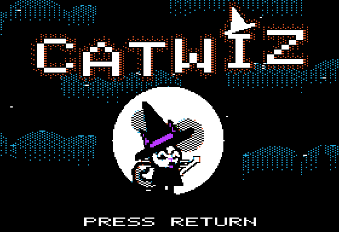
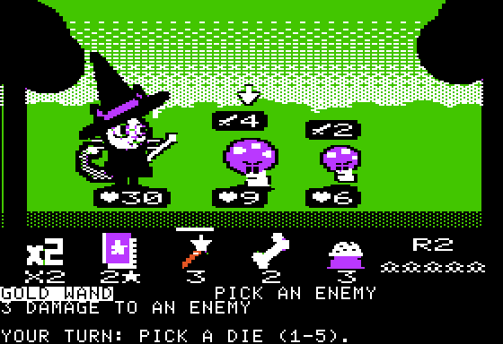
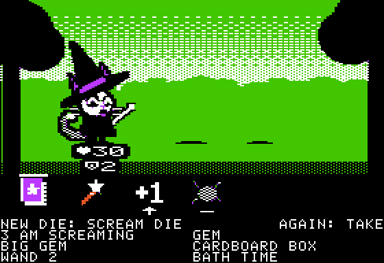
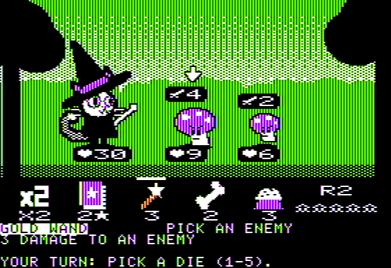

# Catwiz

A dice roguelike for the 128K Apple IIe, in hi-res graphics. You are a cat wizard rolling a bag
of dice against the forest's spooky-cute things, on the way to a big bad dog. Written in
[Tisple](https://github.com/wegfawefgawefg/tisple), a typed Lisp that compiles to 6502.

Two fights and the reward between them play now; ten are planned. The project is shelved.

 

 

## Playing

Each turn five dice come out of your bag and roll. Each face is something to do: a wand hits,
a bone heals, kibble shields you till your next turn, a gem adds mana, a book casts a spell
that costs mana, +1 and x2 boost the next die, and some faces are curses for an enemy. The
enemies show what they will do next. At the end of the turn the dice go to the discard; when
the bag runs out, the discard is shuffled back in. After a won fight you pick a reward: a new
die for the bag, one face of a die upgraded, or a die taken out. Hit points and the bag carry
over; losing ends the run.

- 1-5: pick a die. Its name and what it does show at the bottom; arrows show who it goes to.
- Z, X, C: play the picked die on the enemies, left to right. LEFT/RIGHT and RETURN do the same.
- The same number again, or RETURN: play a die that goes to you or to every enemy.
- ESC lets go of the die, R re-rolls the dice not played yet (twice a turn), E ends the turn,
  M meows.
- The reward works the same way with 1-4 (then 1-6).

## Building

Needs Tisple at commit 71899ed or later (C++20, CMake, Ninja; see its README):

```sh
git clone https://github.com/wegfawefgawefg/tisple
cd tisple && cmake --preset release && cmake --build --preset release   # tisple/build/tisple
```

Then, anywhere in this repo:

```sh
tisple build      # writes build/catwiz.dsk
```

`tisple.project` holds the settings: the program (`game/main.tsp`), its origin, the disk, and the
machine flags `tisple run` uses. The art is drawn in plain Python 3 (`tools/art/`) and exported to
`game/art/*.tsp`, which are checked in; after changing it, run
`TISPLE=/path/to/tisple/build/tisple python3 tools/art/export.py`.

## Running

`tisple run` builds the disk and plays it in a window with the music (Mockingboard in slot 4)
and clicks, as `tisple.project` says; flags after it win, like `tisple run --scale 3`.
`scripts/run.sh` does the same with `TISPLE` naming the compiler (default
`~/Coding/LangDev/tisple/build/tisple`, else `tisple` on the PATH). By hand, in Tisple's
emulator:

```sh
tisple machine --disk build/catwiz.dsk --window                       # speaker sound
tisple machine --disk build/catwiz.dsk --mockingboard 4 --window      # with music
tisple machine --disk build/catwiz.dsk --window --taps tools/phone/catwiz.json   # mouse taps
```

With `--taps`, clicking a die, an enemy, the re-roll die or the cat presses its key.

On a real enhanced IIe with 128 KB, write `build/catwiz.dsk` to a floppy (ADTPro) or put it on
a FloppyEmu, and boot it. A Mockingboard in any slot plays the music; without one the speaker
plays the effects.

## The repo

- `game/`: the game. `main.tsp` is the loop; `battle/`, `draw/`, `sound/`, `title/` the engine;
  `content/` the rules as plain tables (dice, enemies, statuses, effects, encounters); `art/`
  the generated pictures.
- `tools/art/`: the art, drawn at 280 x 192 in the hi-res colours. `tools/hgr.py` is the canvas
  and the HGR converter; `tools/measure.py` measures frame costs.
- `tools/phone/catwiz.json`: buttons and tap boxes for Tisple's phone player and `--taps`.
- `tools/reference/`: scripts from the prototype; see its README.
- `mockup/`: the hi-res mockups of the battle screen the look came from.
- `shots/`: screenshots; `shots/art/` the export's previews; `shots/history/` the prototype.
- `docs/plan.md`: where it stands and what is left. `AGENTS.md`: the rules for working here.

It started as Witchdog, with a dog witch for a hero, and became Catwiz when the cat took over.

Inspired by Dog Witch and Slay the Spire. The names, art, music and rules here are our own.
